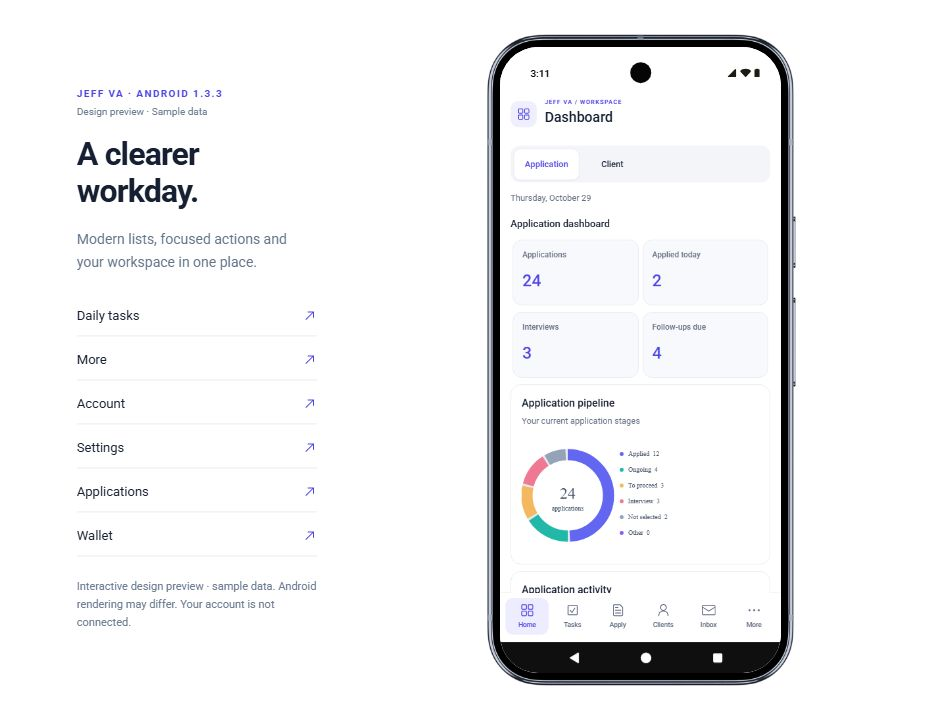
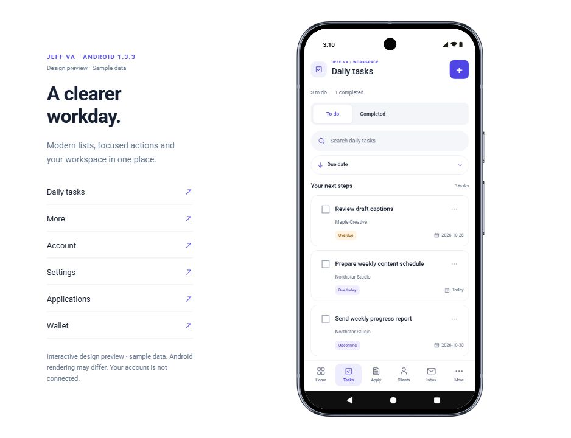
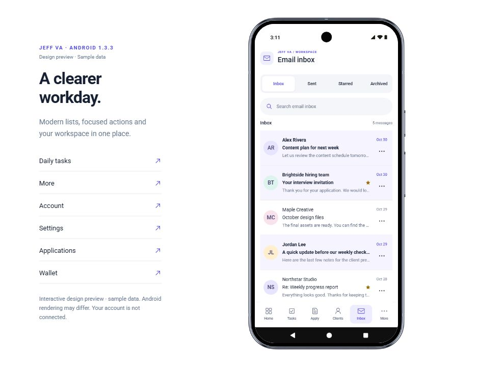

# Jeff VA for Android

A native Android companion to the Jeff VA management system, built with **Java and Android Views**. It brings application tracking, client work, tasks, email organization and account settings into a mobile interface.

The Android app uses the same Supabase account data and Cloudflare APIs as the website. The interface is rendered with Android widgets; it has no WebView or Chrome wrapper.

## Design preview

These screenshots show a **browser design preview with synthetic data**. They are not screenshots of a connected account or an Android emulator. Native layouts can vary with phone size and system font settings.

| Dashboard | Tasks | Email inbox |
| --- | --- | --- |
|  |  |  |

## Features

- Application and client dashboards with charts.
- Application stages, active clients and profile-photo support.
- Tasks with separate To do/Completed lists, sorting and search.
- Email folders, message details, reply/forward and workspace organization.
- Wallet, subscriptions, invoice records and documents.
- Scripts, work links, templates, local cover-letter drafts and salary estimates.
- Account profile, light/dark appearance and opt-in daily reminders.
- Foreground Supabase updates with reconnection and missed-update checks.

This is an evolving companion app. Closed-app push notifications and automatic incoming Gmail delivery require further server setup. Some website workflows, including advanced automation and document-template exports, are not fully ported. Physical-device behavior must be verified separately from the browser preview.

## Source layout

- `project/app/src/main/java/` — native Java screens, data access, authentication and encrypted local storage.
- `project/app/src/main/res/` — Android themes, icons and other resources.
- `project/app/src/test/` — model, account-scoped realtime protocol and reminder regression tests.
- `design-preview/` — a separate interactive UI demonstration using sample records.
- `app-config.example.json` — placeholder configuration for your own deployment.

## Configure and build

1. Copy `app-config.example.json` to `app-config.json` inside this folder.
2. Set your own Supabase URL and publishable key, Cloudflare API origin and authentication callback. Never put a Supabase service-role key or other server credential in an Android app.
3. Configure the backend, per-user access policies, OAuth callback and storage policies. Configuration alone does not grant access to an existing private account.
4. Open `project/` in Android Studio using JDK 17 and Android SDK/build tools 36. The minimum supported Android API is 24.
5. Run the app or build a debug APK from Android Studio. To run tests, use `project/gradlew testDebugUnitTest` (or `gradlew.bat` on Windows).

The optional Windows helper `build-apk.ps1` builds and signs a release when a local toolchain is available. It uses `JAVA_HOME` and `ANDROID_HOME` when set; otherwise it looks for a private `.android-tools/` installation. It creates a local signing identity on first use. Keep that identity backed up securely for future updates. Do not distribute a build configured for an account/service you do not control.

## Privacy and sharing

This repository includes source code, placeholder configuration and sample-data previews. It excludes live mobile configuration, sessions, access/refresh tokens, account snapshots, signing keys/passwords, APKs and local build output. Runtime sessions are created only after a user signs in on their own device and are stored in that device's encrypted app storage.

The public source and screenshots do not grant account access. Backend authorization and row-level policies must protect each deployment. No real emails, client files or session exports are needed to run the design preview.

## Validation

The latest local release build passed 20 unit tests, release lint, APK signature verification and alignment checks. The browser preview passes TypeScript and its mobile-runtime integrity checks. These checks do not establish that every device or live integration has been tested.

Radix-derived vector icons retain their MIT attribution in [RADIX-ICONS-LICENSE.txt](RADIX-ICONS-LICENSE.txt). Repository licensing follows the root project; no additional license is implied by this directory.
